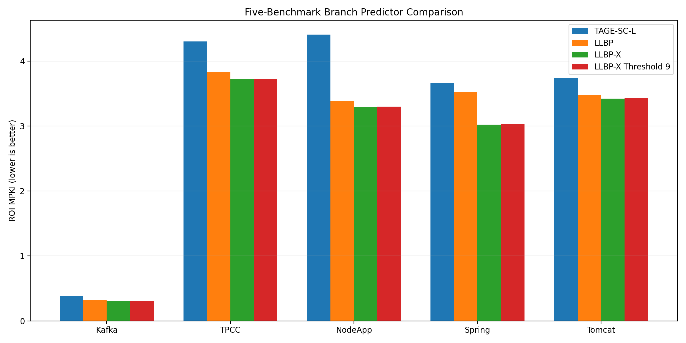
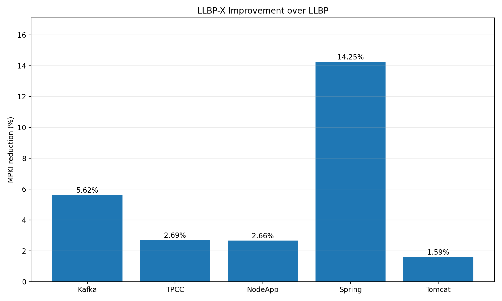
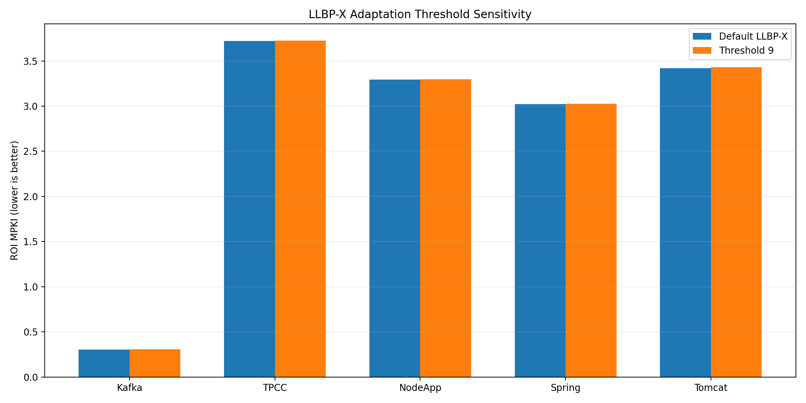
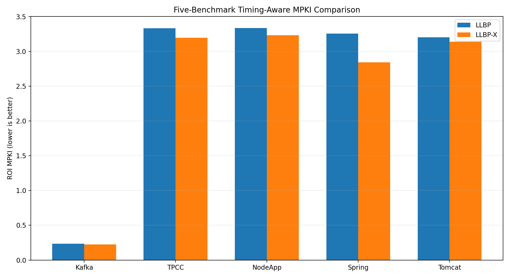
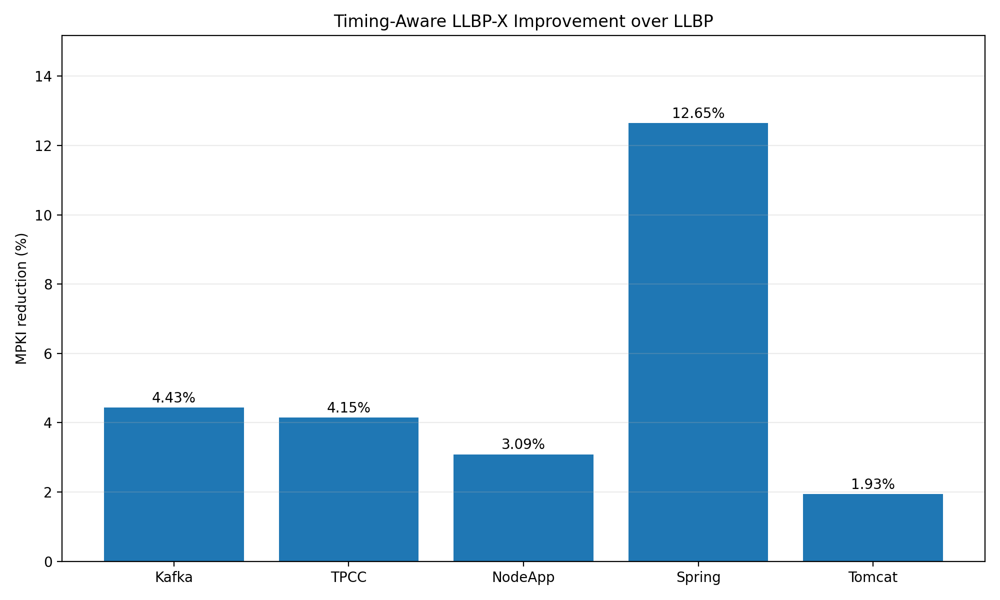
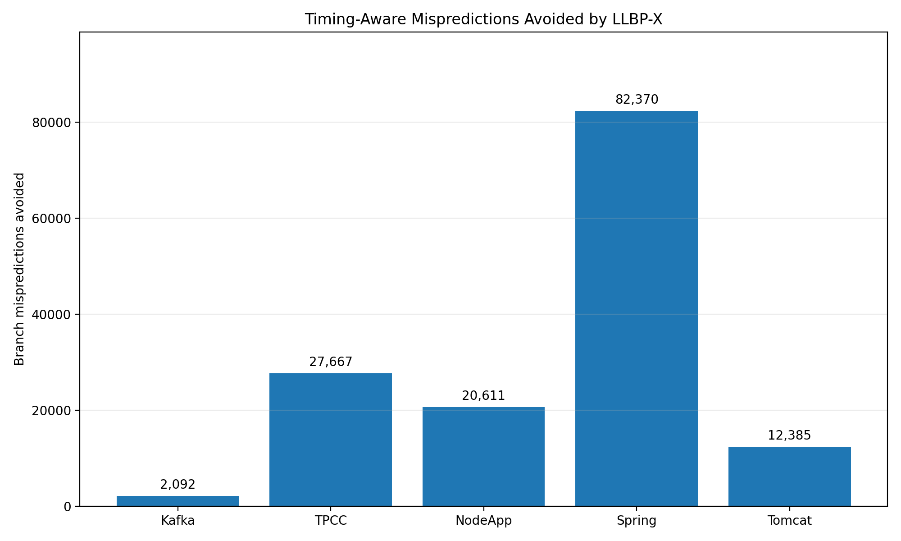

# Chapter 4: Experimental Results and Discussion

## 4.1 Introduction

This chapter presents the five-benchmark experimental evaluation of TAGE-SC-L, LLBP, LLBP-X, and the modified LLBP-X adaptation-threshold configuration. The evaluation comprises **20 zero-latency** and **10 timing-aware** simulations on Kafka, BenchBase TPCC, NodeApp, DaCapo Spring, and DaCapo Tomcat: **30 simulations in total**.

The primary accuracy metric is Region of Interest (ROI) mispredictions per thousand instructions (MPKI). Lower MPKI indicates fewer branch mispredictions per thousand instructions. Results are reported for the simulator's measured ROI, not its warmup period.
## 4.2 Zero-Latency Predictor Results

The four zero-latency predictor configurations were evaluated with 100 million warmup instructions, 100 million requested measurement instructions, and BTB simulation enabled.

**Table 4.1: Zero-Latency ROI MPKI Comparison**

| Benchmark | TAGE-SC-L | LLBP | LLBP-X | LLBP-X Threshold-9 |
|---|---:|---:|---:|---:|
| Kafka | 0.37981 | 0.32264 | 0.30452 | 0.30597 |
| TPCC | 4.30471 | 3.82597 | 3.72292 | 3.72616 |
| NodeApp | 4.40926 | 3.38402 | 3.29396 | 3.29845 |
| Spring | 3.66399 | 3.52562 | 3.02311 | 3.02556 |
| Tomcat | 3.74330 | 3.47568 | 3.42032 | 3.43061 |

**Figure 4.1:** Zero-latency ROI MPKI comparison across five benchmarks.

### 4.2.1 Observations

LLBP-X has the lowest measured ROI MPKI among all four configurations on **all five benchmarks**. The largest relative improvement over LLBP occurs on Spring; Tomcat shows the smallest relative improvement. The direction of the result is consistent across Kafka, TPCC, NodeApp, Spring, and Tomcat.
## 4.3 Zero-Latency Percentage Improvement

For each workload, percentage MPKI reduction is computed as `(Baseline MPKI - LLBP-X MPKI) / Baseline MPKI × 100`. The reported average is the arithmetic mean of the five workload-level percentages, not the percentage change between average MPKI values.

**Table 4.2: LLBP-X MPKI Reduction Relative to LLBP**

| Benchmark | MPKI Reduction |
|---|---:|
| Kafka | 5.62% |
| TPCC | 2.69% |
| NodeApp | 2.66% |
| Spring | 14.25% |
| Tomcat | 1.59% |
| Arithmetic mean of workload reductions | 5.36% |

**Figure 4.2:** Zero-latency LLBP-X MPKI reduction relative to LLBP.

**Table 4.2a: LLBP-X MPKI Reduction Relative to TAGE-SC-L**

| Benchmark | MPKI Reduction |
|---|---:|
| Kafka | 19.82% |
| TPCC | 13.52% |
| NodeApp | 25.29% |
| Spring | 17.49% |
| Tomcat | 8.63% |
| Arithmetic mean of workload reductions | 16.95% |

The largest relative reduction against LLBP occurs on Spring. LLBP-X also reduces MPKI against TAGE-SC-L on every evaluated workload.
## 4.4 Adaptation-Threshold Sensitivity

The experimental `llbpx-threshold9` configuration increases the adaptation threshold from the default value of 7 to 9 while retaining the same zero-latency simulation parameters.

**Table 4.3: Adaptation-Threshold Comparison**

| Benchmark | Default Threshold-7 MPKI | Modified Threshold-9 MPKI |
|---|---:|---:|
| Kafka | 0.30452 | 0.30597 |
| TPCC | 3.72292 | 3.72616 |
| NodeApp | 3.29396 | 3.29845 |
| Spring | 3.02311 | 3.02556 |
| Tomcat | 3.42032 | 3.43061 |

**Figure 4.3:** Adaptation-threshold sensitivity across five benchmarks.

The threshold-9 variant has slightly higher MPKI than the default threshold-7 configuration on **all five workloads**. This experiment does not establish that threshold 7 is globally optimal; only one alternative threshold was evaluated.
## 4.5 Timing-Aware Predictor Results

The timing-aware configurations `llbp-timing` and `llbpx-timing` were evaluated using 100 million warmup instructions, 200 million requested measurement instructions, and BTB simulation enabled.

**Table 4.4: Timing-Aware ROI MPKI Comparison**

| Benchmark | LLBP MPKI | LLBP-X MPKI |
|---|---:|---:|
| Kafka | 0.236015 | 0.225555 |
| TPCC | 3.334090 | 3.195755 |
| NodeApp | 3.336635 | 3.233580 |
| Spring | 3.256150 | 2.844300 |
| Tomcat | 3.201000 | 3.139075 |

**Figure 4.4:** Timing-aware ROI MPKI comparison across five benchmarks.

LLBP-X records lower timing-aware ROI MPKI than LLBP on every evaluated workload. The zero-latency and timing-aware experiments use different measurement intervals, so their absolute MPKI values should not be compared to isolate a timing effect.
## 4.6 Timing-Aware Percentage Improvement

**Table 4.5: Timing-Aware MPKI Reduction Relative to LLBP**

| Benchmark | LLBP-X Improvement |
|---|---:|
| Kafka | 4.43% |
| TPCC | 4.15% |
| NodeApp | 3.09% |
| Spring | 12.65% |
| Tomcat | 1.93% |
| Arithmetic mean of workload reductions | 5.25% |

**Figure 4.5:** Timing-aware LLBP-X MPKI reduction relative to LLBP.

The arithmetic mean of the five workload-level reductions is **5.25%**. This workload-average percentage is not equivalent to the reduction computed from the mean of raw MPKI values; the latter weights the workloads differently.
## 4.7 Reduction in Branch Mispredictions

**Table 4.6: Timing-Aware ROI Mispredictions**

| Benchmark | LLBP Mispredictions | LLBP-X Mispredictions | Mispredictions Avoided |
|---|---:|---:|---:|
| Kafka | 47,203 | 45,111 | 2,092 |
| TPCC | 666,818 | 639,151 | 27,667 |
| NodeApp | 667,327 | 646,716 | 20,611 |
| Spring | 651,230 | 568,860 | 82,370 |
| Tomcat | 640,200 | 627,815 | 12,385 |
| Total | 2,672,778 | 2,527,653 | 145,125 |

**Figure 4.6:** Timing-aware branch mispredictions avoided across five benchmarks.

Across the five separately simulated workloads, LLBP-X records **145,125 fewer ROI branch mispredictions than LLBP**. This total sums five independent benchmark runs; it is not a single application-level speedup measurement.
## 4.8 Discussion and Comparison with the Original Paper

The experimental trend supports the paper's central finding that LLBP-X can improve branch prediction accuracy over LLBP and a TAGE-SC-L baseline. Across the five selected workloads, LLBP-X improves zero-latency MPKI over LLBP by an arithmetic mean of **5.36%** and over TAGE-SC-L by **16.95%**. The timing-aware reduction over LLBP averages **5.25%**.

**Table 4.7: Published TAGE-SC-L MPKI Reference Values Versus This Project**

| Benchmark | Paper TAGE-SC-L MPKI | Project TAGE-SC-L MPKI | Project vs. Paper |
|---|---:|---:|---:|
| Kafka | 0.26 | 0.37981 | +46.1% |
| TPCC | 3.74 | 4.30471 | +15.1% |
| NodeApp | 4.43 | 4.40926 | -0.5% |
| Spring | 3.58 | 3.66399 | +2.3% |
| Tomcat | 3.40 | 3.74330 | +10.1% |

*Paper values in Table 4.7 are reference values transcribed during the project review from Table I of the original research paper. Verify the transcription against the paper before final submission. The difference column is `(Project - Paper) / Paper × 100`; it is a comparison of measured MPKI, not a speedup.*

The published study evaluates **14 workloads** and reports broader aggregate results. This project covers **five** of those workloads, and the zero-latency measurement window used here is **100 million instructions**, rather than the **200 million ROI instructions** used in the paper's reported evaluation. Consequently, the two studies' absolute MPKI and aggregate improvement figures are not directly interchangeable. Differences may arise from ROI selection, trace processing, simulator settings, and the smaller benchmark subset. The project reproduces a consistent improvement trend, not an exact numerical replication of the full paper.

The results do not isolate the contribution of individual internal LLBP-X mechanisms, and no full-system IPC or execution-time speedup was measured.
## 4.9 Limitations of the Results

1. Only **five of the original fourteen workloads** were evaluated.
2. Results come from branch predictor simulations rather than full-system processor performance measurements.
3. Zero-latency and timing-aware experiments use different ROI lengths (100 million versus 200 million requested instructions), so differences between the two sets cannot be attributed solely to timing effects.
4. The adaptation-threshold experiment compares only thresholds 7 and 9.
5. Absolute MPKI comparisons with the paper are affected by differences in experimental windows and potentially other settings.
6. The evaluation reports branch prediction accuracy; it does not establish processor speedup, energy efficiency, or silicon area.

Accordingly, this is a partial reproduction and focused experimental evaluation, not a complete replication of the published study.
## 4.10 Summary

The 30 simulations cover five benchmarks and six predictor configurations across two experiment sets. LLBP-X improves zero-latency ROI MPKI over LLBP by an arithmetic mean of **5.36%**, and timing-aware ROI MPKI by **5.25%**. The threshold-9 variant does not outperform the default threshold-7 configuration on any of the five benchmarks. The timing-aware LLBP-X runs record **145,125 fewer mispredictions in total** than the corresponding LLBP runs.

The improvements are consistent with the direction of the original paper's findings, while the smaller benchmark set and different experimental windows limit direct numerical comparisons. Chapter 5 presents conclusions and future work.
